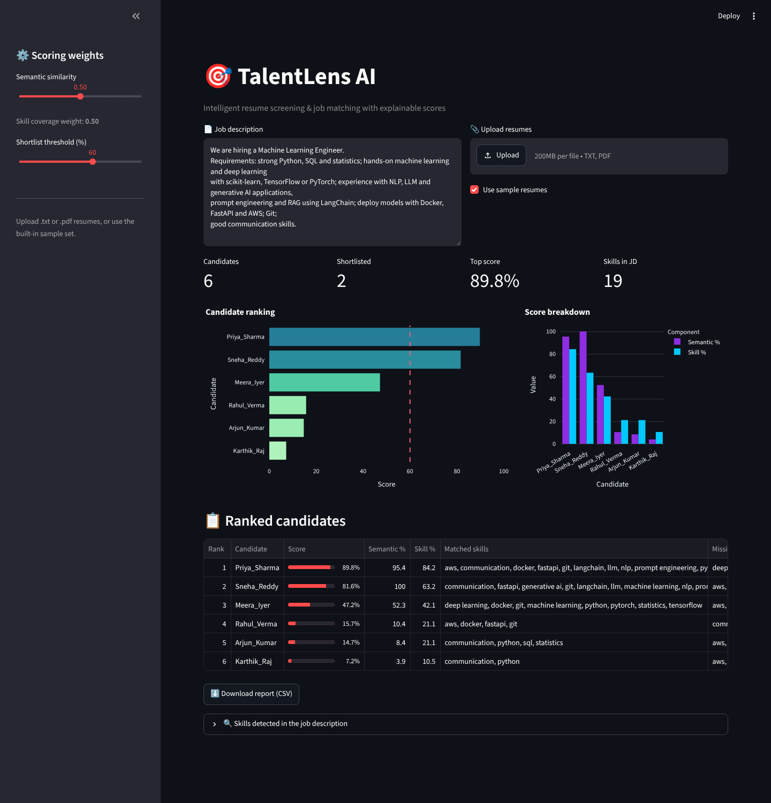
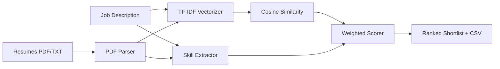

<div align="center">

# 🎯 TalentLens AI — Intelligent Resume Screening & Job Matching

**Rank hundreds of resumes against a job description in seconds — with transparent, explainable scores.**

    

`Artificial Intelligence · NLP`

</div>

---



## 📌 Problem Statement

Recruiters spend 6–8 seconds per resume and still miss strong candidates. Keyword filters in ATS tools are rigid and opaque.

## ✨ Key Features

- Upload **PDF / TXT** resumes in bulk or try the built-in sample set
- **Hybrid score** = TF-IDF semantic similarity (unigrams + bigrams) + skill-coverage ratio
- Skill extraction from a 45+ skill taxonomy with **matched vs missing skills** per candidate
- Adjustable weights and shortlist threshold from the sidebar
- Ranking chart, score-breakdown chart and **CSV report export**

## 🏗️ Architecture



## ⚙️ How It Works

1. Text is normalised and vectorised with **TF-IDF** (`ngram_range=(1,2)`, sublinear TF).
2. **Cosine similarity** between the JD vector and every resume gives the semantic score (rescaled to the best match).
3. Regex-based **skill matcher** finds skills in the JD and in each resume → coverage = matched / required.
4. Final score = `w × semantic + (1 − w) × skill coverage`, shortlisting candidates above the threshold.

## 🧰 Tech Stack

| Layer | Tools |
|---|---|
| Language | Python 3.10+ |
| ML / Logic | pandas, scikit-learn, pypdf |
| UI & Visualisation | Streamlit, Plotly |

## 📁 Project Structure

```
AI-RESUME-SCREENER/
├── app.py             # Streamlit UI — inputs, KPIs, charts, ranked table
├── matcher.py         # Matching engine: parsing, skill extraction, TF-IDF scoring, sample data
├── assets/              # screenshots
├── requirements.txt
└── README.md
```

## 🚀 Getting Started

```bash
git clone https://github.com/PreciousBharath/AI-RESUME-SCREENER.git
cd AI-RESUME-SCREENER
python -m venv venv && source venv/bin/activate   # Windows: venv\Scripts\activate
pip install -r requirements.txt
streamlit run app.py
```

Open **http://localhost:8501** in your browser.

> The project ships with a realistic built-in demo dataset, so it runs out of the box with no downloads or API keys.

## 🗺️ Roadmap

- [ ] Sentence-transformer embeddings for deeper semantic matching
- [ ] LLM-generated interview questions per candidate
- [ ] Bias audit report (name/gender-blind scoring)

## 👨‍💻 Author

**Bharath** — Software Developer · Project Engineer · Technical Trainer

[](https://linkedin.com/in/connectbharath)
[](https://itsbharathportfolio.netlify.app)
[](https://github.com/PreciousBharath)

⭐ If this project helped you, please give it a star!

## 📄 License

Released under the [MIT License](LICENSE).
